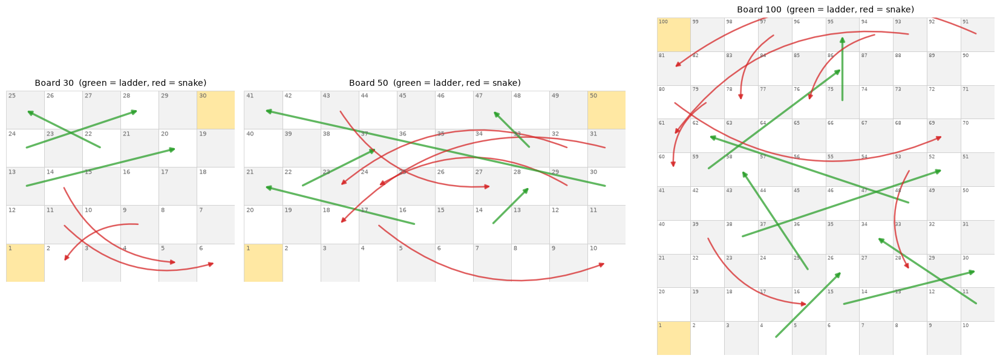
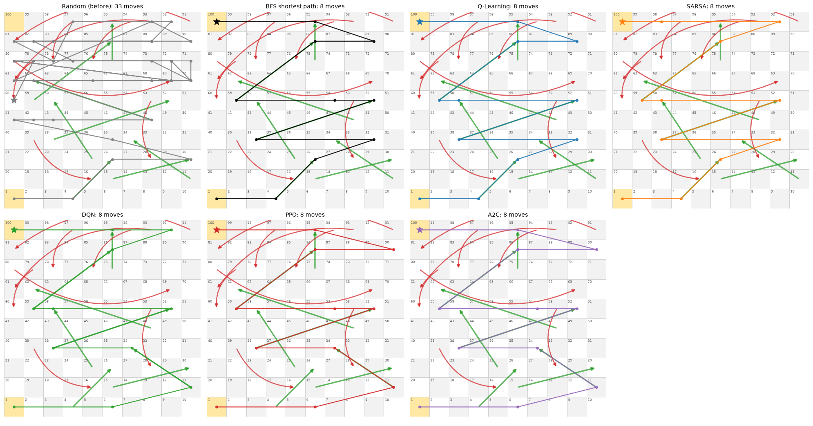
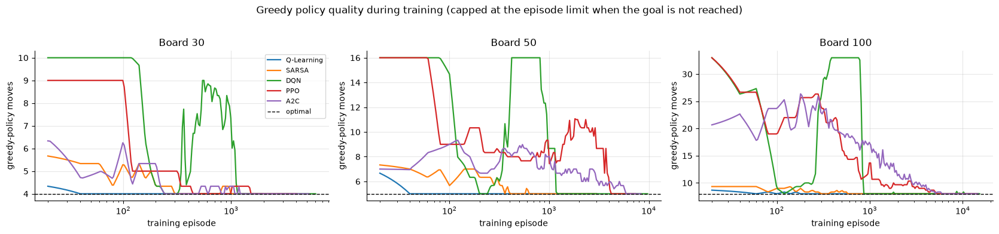
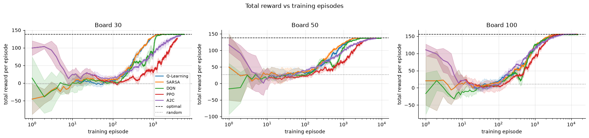
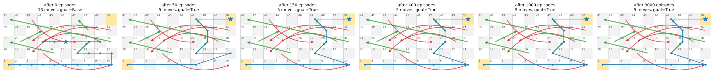
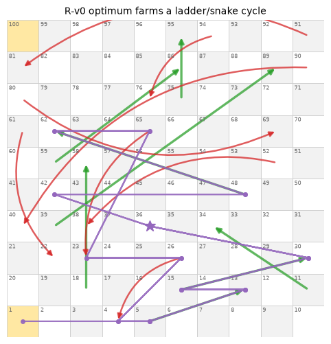
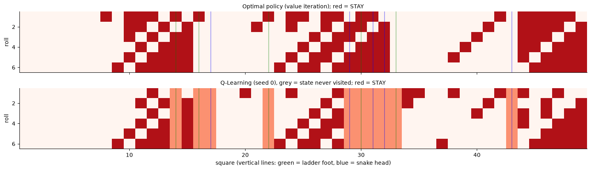
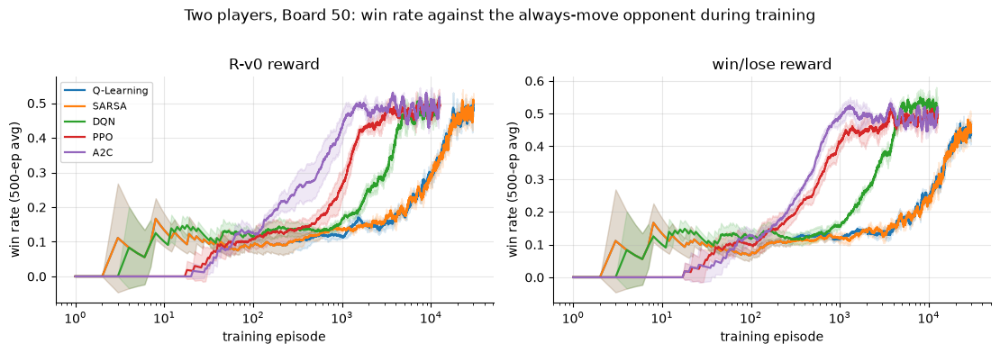

# Learning to Win at Snakes & Ladders

**A comparative study of tabular and deep reinforcement learning on a configurable Snakes & Ladders environment.**

An agent learns to play a snakes-and-ladders dice game from scratch. Five algorithms are compared:
**Q-Learning, SARSA, DQN, PPO and A2C**, the last three via [stable-baselines3](https://stable-baselines3.readthedocs.io/).
The comparison spans six game variants, from a fully controllable board to stochastic dice, a one-time snake shield,
a two-player race and boards that change every game. Every learned policy is measured against exact references:
**BFS** shortest paths and **value-iteration** optima.

Everything (environment, agents, experiments, figures and discussion) lives in one reproducible notebook:
[`snakes_ladders_rl.ipynb`](snakes_ladders_rl.ipynb).

---

## Highlights

- **A custom Gymnasium environment** (`DiceBoardEnv`, `TwoPlayerEnv`). It passes both the Gymnasium and the SB3
  environment checkers and supports chosen or random dice, a snake shield, dynamic boards, one-hot or feature
  observations, and potential-based reward shaping.
- **All five algorithms find the optimal route** on the 30, 50 and 100-square boards, on every seed. Their routes have
  exactly the BFS number of moves and reach the value-iteration optimum return.
- **Reward hacking, found and explained.** On boards with long jumps, a +20 ladder bonus makes the optimal policy loop
  ladder → snake → ladder forever instead of finishing.
- **Two DQN failure modes diagnosed and fixed.** Both trace back to large reward magnitudes interacting with the Huber
  loss. One is slow value fitting with random dice; the other is a median-like bias on the snake-shield task. Both are
  backed by ablations.
- **Generalisation.** On boards re-generated every game, PPO with local look-ahead features wins 100 % of games in
  1.08× the BFS optimum, while memorised tabular policies collapse to 34–51 % wins.
- **Strategic decisions.** Q-Learning and DQN learn to *save* a one-time snake shield for the snakes near the goal,
  within 1.5 points of the exact optimum. In a two-player race, only DQN trained on a win/lose reward beats the classic
  player.
- **An honest comparison with classical methods.** It shows when BFS or a simple greedy rule is the better tool, and
  when reinforcement learning earns its place.

## The game

A board has *N* squares with snakes (move down) and ladders (move up). The player starts on square 1 and must land
exactly on square *N*; overshooting is an invalid move.

| Variant | Agent's decision | State | Notebook section |
|---|---|---|---|
| **Chosen dice** (core) | dice value 1–6 | square | 5–7 |
| **Random dice** | stay or move, after seeing the roll | (square, roll) | 8.1 |
| **Snake shield** | move, or move and spend a one-time shield | (square, roll, shield left) | 8.2 |
| **Two players** (bump rule) | stay or move | (own square, roll, opponent's square) | 8.3 |
| **Larger boards** (200 / 400 squares) | dice value | square or 26 features | 9 |
| **Dynamic board** (new layout each game) | dice value | 26 local look-ahead features | 10 |

**Reward (R-v0):** +100 goal, +20 ladder, −20 snake, −1 normal move, −10 invalid move (the player stays). Variants
studied: R-v1 (no ladder bonus), potential-based shaping, and a win/lose-only reward for the two-player race.

## Algorithms

| Algorithm | Family | Why it is included |
|---|---|---|
| **Q-Learning** | tabular, off-policy TD | classical baseline; learns the greedy policy while exploring |
| **SARSA** | tabular, on-policy TD | shows how on-policy values account for exploration risk |
| **DQN** | deep, value-based, off-policy | deep version of Q-Learning; replay makes it sample-efficient |
| **A2C** | deep, actor-critic, on-policy | simplest policy-gradient actor-critic |
| **PPO** | deep, actor-critic with clipped updates | robust default; comparing it with A2C isolates the effect of clipping and batch reuse |

All agents use ε-greedy exploration (tabular, DQN) or entropy-regularised stochastic policies (PPO, A2C). Each
experiment is repeated with **3 seeds**. Convergence is reached when the greedy policy is within one move of the optimum
for three consecutive evaluations.

## Key results

**Benchmark boards (chosen dice, mean of 3 seeds)**

| Board | BFS optimum | Random policy wins | All 5 algorithms | Episodes to converge (Q-L / SARSA / DQN / PPO / A2C) |
|---|---|---|---|---|
| 30 squares, 3 snakes, 3 ladders | 4 moves | 29 % | 100 % wins, 4 moves | 20 / 113 / 173 / 120 / 54 |
| 50 squares, 5 / 5 | 5 moves | 52 % | 100 % wins, 5 moves | 33 / 293 / 180 / 1 640 / 1 253 |
| 100 squares, 8 / 8 | 8 moves | 52 % | 100 % wins, 8 moves | 20 / 87 / 107 / 1 127 / 2 101 |

**Extensions**

| Variant | Result |
|---|---|
| Random dice (50 squares) | Q-Learning and DQN match the exact optimum (return 126.6). PPO and A2C reach about 102–105. Always moving gets 47. |
| Larger boards (200 / 400) | Every method finds the optimum. Tabular Q-Learning is the most sample-efficient (14k / 58k steps), ahead of DQN (31k / 92k). |
| Dynamic board | PPO: 100 % wins at 1.08× BFS. A2C: 1.17×. DQN: 1.20×. Position-only Q-Learning: 51 % wins. A hand-written greedy rule: 1.02×. |
| Snake shield (100 squares) | Exact optimum: return 45.9, against 10.0 when never using the shield. Q-Learning reaches 45.1 and DQN (rewards × 0.01) 44.5, both by saving the shield for late snakes. SARSA: 42.7. PPO and A2C (about 30) only learn "use it at once". |
| Two players (bump rule) | Trained on the standard reward, every learner wins only 48–50 % against a classic player: they dodge snakes and lose tempo. With a win/lose-only reward, **DQN wins 54.0 %**, matching a hand-tuned cautious rule (54.1 %). |

## Figures

| | |
|---|---|
|  |  |
| **Benchmark boards.** Green arrows are ladders, red are snakes. | **Learned routes on the 100-square board.** Every algorithm finds an 8-move route, matching BFS. |
|  |  |
| **Greedy-policy moves during training** (dashed line = optimum). | **Total reward per episode** (mean ± std over 3 seeds). |
|  |  |
| **Q-Learning's route as training progresses.** | **Reward hacking.** With a +20 ladder bonus, the optimal policy farms a ladder/snake cycle forever. |
|  |  |
| **Random dice:** when to skip a turn (red), learned vs optimal. | **Two-player race:** win rate under the standard and the win/lose reward. |

## Repository layout

```
snakes_ladders_rl.ipynb   the whole study: environment, agents, experiments, figures, discussion
results/                  cached training logs (*.pkl) and summary tables (*.csv)
models/                   trained DQN / PPO / A2C models (*.zip, 3 seeds) for the three benchmark boards and random dice
figures/                  figures used in this README
requirements.txt          Python dependencies
```

## Getting started

```bash
python -m venv .venv
# Windows: .venv\Scripts\activate      macOS / Linux: source .venv/bin/activate
pip install -r requirements.txt
pip install jupyterlab                 # or open the notebook in VS Code
jupyter lab snakes_ladders_rl.ipynb
```

The notebook loads the cached results from `results/` and runs top to bottom in under a minute. To retrain everything
from scratch, set `RETRAIN = True` in the first code cell. This takes about 2–2.5 hours on a laptop CPU (about 128
minutes of recorded training time). A GPU is not needed: the networks are small MLPs and run fastest on a single CPU
thread.

To execute the notebook headlessly:

```bash
jupyter nbconvert --to notebook --execute snakes_ladders_rl.ipynb --inplace --ExecutePreprocessor.timeout=-1
```

## Reproducibility

- Seeds 0, 1 and 2 for every learning run; fixed seeds for every board layout and evaluation set.
- Exact references: BFS (minimum rolls) and value iteration on the full tabular model (optimal return).
- Tested with Python 3.14, Gymnasium 1.4, stable-baselines3 2.9 and PyTorch 2.15 (CPU).

## License

[MIT](LICENSE)
